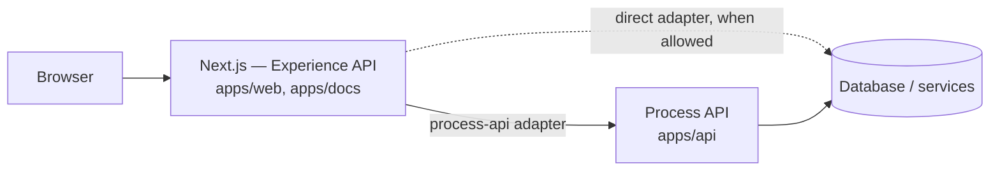

# Constitution — Next.js Monorepo

Base rules of the monorepo. Every feature, refactor or fix must comply with this document. If a request **conflicts** with this constitution, **stop and ask the user** before implementing: explain the conflict, the options (follow the constitution, follow the request as a one-off exception, or update the constitution) and wait for the decision. Never resolve the conflict on your own.

Items marked `[TBD]` are pending decisions; do not invent values for them — ask.

**Autonomy:** everything this constitution requires is done without asking for permission (writing tests, running every validation, updating docs and the changelog, applying the design system, etc.). Ask the user only when a rule explicitly demands a question (conflicts with this document, `[TBD]` items, design assets, storage path, notification channel, project setup) or when information that cannot be discovered is missing.

---

## 1. Purpose

Standard for monorepos with Next.js frontends, a Process API backend, documentation and a component catalog (Storybook), using a DDD architecture in which **every external dependency (SDKs, services, databases, APIs, tools) is isolated in infra and replaceable through configuration**.

### 1.1 API layer architecture



- **Experience API (Next.js):** route handlers, Server Actions and Server Components. Orchestrates and adapts data for the user experience (BFF). Contains no process rules.
- **Process API (`apps/api`):** separate backend holding the process/business rules and access to systems of record.
- In Next.js, the business layer **does not know** where the data comes from: the port is the same, and the adapter selected by configuration can call the **Process API (REST)** or access the **database/service directly**.
- The browser **never** calls the Process API directly; it always goes through the Experience API.

---

## 2. Monorepo

```
/
├── apps/
│   ├── web/            # main application (Next.js, Experience API via route handlers/server actions)
│   ├── docs/           # documentation application (Next.js, its own Experience API)
│   ├── api/            # Process API (separate backend)
│   ├── listeners/<name>/   # asynchronous queue listeners, one app per listener (see § 9.2)
│   └── storybook/      # catalog of React components from web and docs (deployed separately)
├── packages/           # shared code and configuration
│   ├── config-eslint/
│   ├── config-typescript/
│   ├── config-tailwind/    # theme: design tokens only (colors, fonts, spacing, radii, shadows)
│   ├── design-system/      # reusable UI components built with Tailwind + the theme tokens
│   ├── config-vitest/
│   └── core/               # generic building blocks (AbstractFactory, ConfigManager port/adapters, base errors)
├── design-assets/      # input provided by the user: icons, screens, logos, fonts, references (see § 10)
├── deploy/             # Firebase configuration and deployment files (see § 14)
├── CONSTITUTION.md
└── package.json
```

- Next.js acts as the **Experience API** (route handlers `app/api/**/route.ts`, Server Actions); process rules live in the **Process API** (`apps/api`).
- `apps/web`, `apps/docs` and `apps/api` follow **the same standards** (same DDD architecture, lint, tsconfig, tests, coverage). `apps/storybook` follows the same lint and tsconfig.
- Package manager: **pnpm workspaces** + **Turborepo** for task orchestration (build/test/lint only on affected packages, with caching). Note: Vite is not a package manager; it enters the project through **Vitest** and Storybook. Next.js uses its own bundler (Turbopack).
- The deployment directory is named `deploy/` to avoid colliding with the `infra/` layer of the applications.

### 2.1 Version control (Git)

- The whole monorepo is **always controlled by Git**. Nothing is delivered outside version control.
- The repository must have a root `.gitignore`, and **the agent must add/update the necessary `.gitignore` entries** whenever a request introduces new tooling, apps or generated artifacts. At minimum: `node_modules/`, `.next/`, `dist/`, `build/`, `coverage/`, `storybook-static/`, `.turbo/`, `.env*` (except `.env.example`), `.firebase/`, `*-debug.log`, service account keys (`*serviceAccount*.json`, `*-adminsdk-*.json`), logs (`*.log`), and OS/editor files (`.DS_Store`, `.idea/`; keep shared `.vscode/` files such as `mcp.json` only if they contain no secrets).
- Secrets, local env files and generated build output are never committed.

---

## 3. Stack

| Item | Choice |
|---|---|
| Language | TypeScript (`strict: true`, no implicit `any`) |
| Framework (frontends / Experience API) | Next.js — **latest stable version**, App Router |
| Framework (Process API) | **Fastify** (TypeScript, Node.js), with Zod schemas and OpenAPI generated from the routes |
| Process API contract | OpenAPI 3 (source of the contract; clients in the `process-api` adapter are generated/validated from it) |
| Runtime | Node.js LTS |
| UI | **Tailwind CSS only**, with a project-specific theme (`packages/config-tailwind`) and design system (`packages/design-system`) generated from the user-provided design assets (§ 10) |
| Input validation | Zod (at every boundary: route handlers, server actions, adapters) |
| Authentication | Firebase Authentication, behind the `auth` port (`firebase-auth`) |
| Database | Cloud Firestore, behind repository ports (`firestore`) |
| File storage | Cloud Storage for Firebase, behind the `storage` port (`firebase-storage`) |
| Backend runtime | Cloud Functions for Firebase, 2nd gen |
| Scheduled jobs | Cloud Scheduler via Firebase scheduled Functions |
| Unit tests | Vitest |
| Component tests | React Testing Library + Vitest (jsdom) |
| API tests | Supertest (Next.js route handlers and Process API endpoints) |
| E2E tests | Playwright |
| Component catalog | Storybook (`@storybook/nextjs-vite` framework) |
| Async messaging | Firebase task queue Functions (Cloud Tasks), behind the `queue` port (`firebase-tasks`); Pub/Sub for fan-out when needed |
| CI/CD and deploy | GitHub Actions → Firebase (§ 14) |

### 3.1 Package registry

- Packages are installed from the public npm registry unless the user states otherwise. Use a lockfile (`pnpm-lock.yaml`) and install with `--frozen-lockfile` in CI.
- If a private registry is needed, the token is never written in any file: `.npmrc` references an environment variable (e.g. `${NPM_TOKEN}`), the real `.npmrc` is gitignored (§ 2.1) and only a `.npmrc.example` is committed.

---

## 4. Architecture (DDD + Ports & Adapters)

### 4.1 Structure per application

Each app (`apps/web`, `apps/docs`, `apps/api`) follows **exactly** this structure inside `src/` (delivery folders vary by app type, see below):

```
src/
├── domain/
│   ├── aggregates/<domain>/           # root entities + invariants
│   ├── value-objects/<domain>/        # immutable objects, validated on creation
│   ├── ports/<infra-type>/            # infra contracts (interfaces)
│   │   ├── config/
│   │   ├── auth/                     # Firebase Authentication
│   │   ├── cms/
│   │   ├── repositories/             # data access (direct database or Process API)
│   │   ├── email/
│   │   ├── queue/
│   │   ├── ai/
│   │   ├── storage/
│   │   └── <other-type>/             # one directory per infra type
│   └── usecases/<domain>/             # business contracts (interfaces), one file per use case
├── application/<domain>/              # usecase implementations, one file per use case
├── infra/
│   ├── adapters/<infra-type>/<implementation>/   # mirrors domain/ports
│   │   ├── cms/json/
│   │   ├── config/json/
│   │   ├── config/env/                # future
│   │   ├── auth/<provider>/
│   │   ├── repositories/process-api/  # REST to the Process API (default in Next.js apps)
│   │   └── repositories/<database>/   # direct database access
│   └── factories/<domain>/            # ONE factory per domain, mirrors application/
│
│   # Delivery folders — Next.js apps (web, docs):
├── app/                               # Next.js App Router (pages, layouts, route handlers, server actions)
├── components/                        # presentational React components
├── lib/server/                        # server-only helpers that instantiate factories
│
│   # Delivery folders — Process API (api):
├── http/                              # routes/controllers, input schemas, middlewares (auth)
└── main.ts                            # server bootstrap
```

### 4.2 Example `orders` domain

```
domain/usecases/orders/get-order.usecase.ts                   → interface GetOrderUseCase
domain/usecases/orders/list-orders.usecase.ts                 → interface ListOrdersUseCase
application/orders/get-order.ts                               → class GetOrder implements GetOrderUseCase
application/orders/list-orders.ts                             → class ListOrders implements ListOrdersUseCase
domain/ports/repositories/order-repository.port.ts            → interface OrderRepositoryPort
infra/adapters/repositories/process-api/process-api-order-repository.adapter.ts → class ProcessApiOrderRepositoryAdapter implements OrderRepositoryPort
infra/adapters/repositories/<database>/<database>-order-repository.adapter.ts   → class <Database>OrderRepositoryAdapter implements OrderRepositoryPort
infra/factories/orders/orders.factory.ts                      → class OrdersFactory extends AbstractFactory
```

In Next.js, `GetOrder` receives an `OrderRepositoryPort` and does not know whether the data came from the Process API or the database — this is decided by the `infra.repositories.provider` shift key.

### 4.3 Dependency rules (mandatory, enforced by lint)

| Layer | May import | May not import |
|---|---|---|
| `domain` | only `domain` | `application`, `infra`, `app`, `components`, React, Next.js, external SDKs |
| `application` | `domain` | `infra`, `app`, `components`, external SDKs |
| `infra/adapters` | `domain`, external SDKs | `application`, `app`, `components` |
| `infra/factories` | `domain`, `application`, `infra/adapters`, `packages/core` | `app`, `components` |
| `lib/server` | `infra/factories`, `domain` (types) | `application` and `infra/adapters` directly |
| `app`, `components` | `lib/server` (server only), `domain` (types/VOs) | `application`, `infra` directly |
| `http` (Process API) | `infra/factories`, `domain` (types/VOs) | `application`, `infra/adapters` directly |

- Enforced via ESLint (`eslint-plugin-boundaries` or `no-restricted-imports`) — a violation breaks the build.
- **External SDKs, clients and tools may only be imported inside the corresponding adapter** (`infra/adapters/<type>/<impl>/`). Testing tools used to test the application itself (e.g. Playwright in `tests/e2e`) are not a violation.
- Adapters convert external errors into domain errors; SDK errors never leak into `application`.

### 4.4 Naming conventions

| Artifact | File | Symbol |
|---|---|---|
| Port | `<name>.port.ts` | `interface <Name>Port` |
| Usecase (contract) | `<action>-<entity>.usecase.ts` | `interface <Action><Entity>UseCase` with an `execute(input)` method |
| Usecase (impl.) | `<action>-<entity>.ts` (variants: `<variant>-<action>-<entity>.ts`) | `class <Action><Entity>` / `class <Variant><Action><Entity>` |
| Adapter | `<impl>-<name>.adapter.ts` | `class <Impl><Name>Adapter` |
| Factory | `<domain>.factory.ts` | `class <Domain>Factory` |
| Aggregate | `<name>.aggregate.ts` | `class <Name>` |
| Value Object | `<name>.vo.ts` | `class <Name>` |

- Folders and files in `kebab-case`; classes in `PascalCase`.
- **Everything in English** (mandatory): comments, file and folder names, variables, functions, classes, types, shift keys, config keys, error messages, test and story names, commit messages, and all Markdown documentation (constitution, skills, READMEs). Exception: end-user content (CMS, `content/<locale>/`), which follows the corresponding locale.
- The factory name is the **domain**, not the implementation (e.g. `OrdersFactory`, not `PostgresOrdersFactory`) — the implementation is chosen by configuration (section 6).

### 4.5 Data connection lifecycle, idempotency and concurrency

- **Firestore:** reuse the initialized Admin SDK client inside infra; it is not a checked-out SQL connection. Create each transaction inside the operation and never retain transaction objects across requests. Transaction callbacks may retry: perform no external side effects inside them; use a transactional outbox for queued work. Map exhausted concurrency conflicts to domain conflicts.
- **Database connections are request-scoped (for connection-based adapters):** every database operation acquires a connection for the request/transaction, uses it, commits or rolls back, and closes/releases it before the request completes. Never keep a database connection, transaction or cursor in module/global state, a singleton adapter, an application service or a long-lived listener. A pool may be managed by the infrastructure adapter, but each request must acquire and release its connection; no connection may remain checked out between requests.
- **Every mutation must be state-aware:** before changing any persisted record, the Process API must read or lock the current state and validate that the requested transition is allowed by the domain. The check and mutation must be atomic in one transaction. Example: changing a document to `completed` must verify the current status and version; an already completed, cancelled or concurrently changed document must not be overwritten silently.
- Prefer **optimistic concurrency** with a version/updated-at condition (`UPDATE ... WHERE id = ? AND version = ? AND status = <allowed current state>`) and increment the version atomically. Use a database lock (`SELECT ... FOR UPDATE`) or the database's transactional primitives when the domain requires serialized transitions. A failed condition is a domain conflict returned as HTTP `409 Conflict`, never a silent success.
- **Every command is idempotent:** accept an idempotency key/correlation id, persist its result or use a unique constraint, and return the original result for a retry. Queue listeners must deduplicate before applying side effects. Retries must not create duplicate records, transitions, notifications, files or external calls.
- Idempotency keys, version checks, allowed transitions, conflict behavior and retry semantics belong in the domain/application contract and are enforced by the repository adapter; they must be covered by tests for duplicate requests and concurrent updates.

---

## 5. Factories

- **One factory per domain, one file**, in `infra/factories/<domain>/`.
- Every factory extends `AbstractFactory` (from `packages/core`) and **receives a `ConfigManager` in the constructor**.
- The factory is the **only place** that reads configuration and injects it, via constructor, into `application` and `infra` classes. `application` classes and adapters **never** read config/env directly.

Reference contract:

```ts
export abstract class AbstractFactory<TService, TInfra> {
  constructor(protected readonly config: ConfigManager) {}

  /** Assembles everything: infra + service. Entry point used by the UI/route handlers. */
  make(): TService {
    return this.makeService(this.makeInfra());
  }

  /** Instantiates the application implementations (usecases) selected by config. */
  protected abstract makeService(infra: TInfra): TService;

  /** Instantiates the adapters (ports) selected by config. */
  protected abstract makeInfra(): TInfra;
}
```

- `TService` is an object with the domain usecases (e.g. `{ getOrder, listOrders }`).
- Unknown selection key → the factory throws an explicit error (fail fast), never a silent fallback.

---

## 6. Swapping implementations through configuration (shift keys)

Every port with an adapter and every usecase with an implementation **must** have a selection key in the configuration, even if there is currently a single implementation.

Key pattern:

```jsonc
{
  "infra": {
    "repositories": {
      "provider": "process-api",              // adapter shift key: process-api | <database>
      "process-api": { "baseUrl": "https://process-api.internal", "timeoutMs": 5000 },
      "<database>": { "urlEnv": "DATABASE_URL" }
    },
    "cms": { "provider": "json", "json": { "contentDir": "content" } }
  },
  "domains": {
    "orders": {
      "usecases": {
        "getOrder": "default",                // usecase shift key
        "listOrders": "default"
      }
    }
  }
}
```

Rules:
- Adapters: `infra.<port>.provider` + a configuration block named after the provider. When a domain needs a provider different from the port default, use the override `infra.<port>.overrides.<domain>.provider`.
- Usecases: `domains.<domain>.usecases.<usecase>` with the variant name (`default` for the default implementation).
- The factory keeps a **registry** `{ [provider]: () => instance }` — adding an implementation = creating the class + registering it in the factory + documenting the key.
- **Secrets never live in the config file.** The config stores only the **name** of the environment variable/secret (`Env` suffix, e.g. `urlEnv`, `tokenEnv`); the value comes from the environment/secret manager.
- Every new shift key must be **documented in the `docs` app** (key, accepted values, default).

---

## 7. ConfigManager

- Port in `domain/ports/config/config-manager.port.ts` (may live in `packages/core` and be re-exported).
- Initial implementation: **JSON** (`infra/adapters/config/json/`), reading `config/default.json` with a per-environment override `config/<APP_ENV>.json`.
- Planned expansions (same port, new adapters): **env vars**, database-backed config.
- The ConfigManager provider itself is the only choice made through an environment variable: `CONFIG_PROVIDER=json|env` (default `json`).
- Configuration is validated with Zod on load; invalid config prevents the application from starting.

---

## 8. Content (CMS)

- Port in `domain/ports/cms/`. Initial implementation: **JSON files** (`infra/adapters/cms/json/`), with content in `apps/docs/content/<locale>/...`.
- Ready for other CMSs via `infra.cms.provider`.
- No component reads a content file directly — always via usecase → port.

---

## 9. Next.js and React

- **Server Components by default.** `"use client"` only when there is interactivity, state or browser APIs.
- Server Components, Route Handlers and Server Actions obtain services via helpers in `src/lib/server/` (marked with `import 'server-only'`), which instantiate the factory and call `make()`:

  ```ts
  // src/lib/server/orders.ts
  import 'server-only';
  export const orders = () => new OrdersFactory(getConfigManager()).make();
  ```
- Client Components **never** instantiate factories; they consume data via props, Server Actions or route handlers.
- Route handlers and Server Actions validate input with Zod and return domain errors mapped to HTTP consistently.
- Route handlers are **Experience API**: they aggregate/adapt data for the screen. Process rules belong to the Process API.

## 9.1 Process API (`apps/api`)

- Same DDD architecture (domain, application, infra, factories, ConfigManager, shift keys) and same code and test standards.
- Delivery folder `http/`: thin routes/controllers that validate input (Zod), obtain the service from the factory and map domain errors to HTTP.
- **OpenAPI 3** contract versioned in `apps/api/openapi/`; every new or changed route updates the contract. The `process-api` adapter of the Next.js apps is validated against this contract.
- **Swagger UI is mandatory:** the Process API always publishes its OpenAPI contract with Swagger UI at `/docs` (raw document at `/docs/json`), outside `/v1` and without authentication, controlled by the shift key `http.swagger.enabled`. A test must check that it serves the contract and that the contract matches the registered routes. The agent always reports the Swagger link when it hands over the running apps.
- Route versioning (`/v1/...`); breaking changes require a new version.
- Not exposed to the browser: reachable only through the Experience APIs (or protected by service-to-service authentication).
- **Composition root:** each page/feature has a composition point (usually the route's Server Component) that resolves dependencies and data and injects them via props/`children` into pure presentational components. Presentational components do not fetch data or instantiate services. Prefer composition (`children`, compound components) over prop drilling and excessive configuration props.

## 9.2 Asynchronous services and queue listeners

Whenever a request asks for an **asynchronous service** (work that must not block the caller, run later or be retried), the following is mandatory:

- **The async service lives in the Process API (`apps/api`)**, never in the Experience API (Next.js). It is a regular usecase that publishes a message through the `queue` port (`domain/ports/queue/`).
- **The queue is infra:** default to Firebase task queue Functions (Cloud Tasks), behind `infra.queue.provider=firebase-tasks`; use Pub/Sub for fan-out. Names, regions and runtime identity come from configuration. Do not ask the provider again.
- **The listener must be implemented in the same request**, not left for later. It consumes the queue and executes the behavior described in the prompt.
- **Each listener is a separate app** in `apps/listeners/<listener-name>/`, deployed independently from the Process API and the Next.js apps. It follows the same DDD structure, standards, tests and coverage as the other apps: the handler is a thin entry point that obtains the service from a factory; the processing logic lives in `application` usecases; the queue/consumer is accessed through the `queue` port.
- Messages have a versioned, Zod-validated schema shared between producer and listener (in `packages/` or an equivalent contract location). Listeners must be **idempotent** and configure retries and a **dead-letter strategy** appropriate to the provider.
- **Listener runtime is Cloud Functions for Firebase, 2nd gen.** Keep each listener in its own app and Functions codebase. Firebase trigger registration and SDK imports live in `infra/adapters`; the delivery entry point only exports the configured handler. Cloud Tasks has no native DLQ: implement an explicit failed-job store and controlled replay after bounded retries; for Pub/Sub configure a dead-letter topic.
- Document the async flow, message contract, queue shift keys and the listener in `apps/docs`.

---

## 9.3 Storage strategy (files and objects)

Whenever files are involved, use Cloud Storage for Firebase behind the `storage` port and `infra.storage.provider=firebase-storage`. Ask only for an unknown upload/download path, with a skip option:

1. **Through the backend:** authenticated Experience/Process API handles the file.
2. **Direct from the client:** backend authorizes and issues short-lived scoped signed URLs.
3. **Skip:** retain `[TBD]`, implement with a fake adapter locally and defer the real transfer path.

Rules:
- The direct-from-client option still requires the backend to issue the URL/token (usecase in the Process API behind the `storage` port); the browser never receives storage credentials.
- Enforce size and content-type limits, validate metadata with Zod, and keep buckets/containers private by default (when using Firebase Storage, also write the Security Rules).
- Bucket/container names and endpoints come from config; credentials only via env/secret manager (`Env` suffix rule from § 6).
- Document the provider, the chosen path and the shift keys in `apps/docs`.

---

## 9.4 Notifications

Notifications are an **asynchronous service** (§ 9.2) with these specifics:

- The notification service is a usecase in the **Process API** (`apps/api`). It **never sends the notification itself**: it always publishes a message to the **queue** through the `queue` port.
- A **listener** (separate app in `apps/listeners/<name>/`, § 9.2) consumes the queue and delivers the notification through a `notifications` port (`domain/ports/notifications/`) with adapters in `infra/adapters/notifications/<impl>/` (e.g. `email`, `sms`, `push`, `chat`, `mock`), selected by the shift key `infra.notifications.provider`.
- The agent **must ALWAYS ask the user about the listener** before implementing: **what it does/which channel** (email, SMS, push such as Firebase Cloud Messaging, chat, or another); the runtime is Firebase Functions (§ 9.2). The channel question must **always include the option `To be defined (work with mock)`**.
- If the user picks `To be defined (work with mock)`: implement the full flow (service → queue → listener) with a **`mock` notifications adapter** (e.g. structured log and/or in-memory outbox) as the configured provider, mark the real channel as `[TBD]`, and make it replaceable later by only changing the shift key and adding an adapter. Never invent a real channel or credentials.
- Message contract (Zod, versioned) carries channel-agnostic data (recipient reference, template/type, payload, correlation id); the listener must be idempotent and use retries + DLQ.
- Document the flow, message contract, shift keys and pending channel in `apps/docs`.

---

## 10. Look and feel (Tailwind, design assets, design system and theme)

- **Tailwind CSS is the only styling technology.** No third-party component/design-system library is assumed or required; no CSS-in-JS, no other CSS frameworks. Hardcoding colors, fonts, spacing, radii or shadows outside the theme tokens is forbidden.
- **Design assets are provided by whoever uses the skill, never invented.** Before creating or changing any UI, the agent **must ask the user (as a prompt) for the path of the design assets folder** — icons, logos, fonts, screen mockups/screenshots, brand guidelines, color palette, anything that defines the look. The agent must ask for it **every time the folder is unknown** (first UI request of a project, or when the user mentions new assets). If nothing is provided, ask again or confirm with the user whether to proceed with neutral placeholder styling marked `[TBD]`; never fabricate a brand identity.
- Provided assets are copied (or referenced) in `design-assets/` at the repo root and treated as the source of truth. Icons are converted into typed React components (SVG) inside the design system.
- From those assets the agent **creates two separate packages**:
  1. **Theme — `packages/config-tailwind`:** design tokens only (color palette, typography/fonts, spacing scale, radii, shadows, breakpoints, dark mode if applicable), exposed as a Tailwind preset/CSS theme. Contains no components.
  2. **Design system — `packages/design-system`:** reusable, accessible React components (Button, Input, Card, Modal, etc.) and the icon set, built **only with Tailwind classes that use the theme tokens**. Contains no business logic and no data access.
- The theme and the design system are **separate and independently versioned**: changing the visual identity means changing the theme; components never hardcode values. Apps (`web`, `docs`) and Storybook import the theme preset and the design system components; apps may add feature-specific components in their own `components/` using the same tokens.
- Where the design assets include screens/mockups, the agent derives the components and layouts from them and keeps them consistent with the theme.
- Accessibility: **WCAG 2.1 AA** mandatory (semantics, focus, contrast, labels). If the provided palette fails contrast, report it and propose compliant adjustments instead of silently changing it.

### 10.1 Storybook (`apps/storybook`)

- **Every new or changed React component** in `packages/design-system`, `apps/web` or `apps/docs` requires a corresponding story in `apps/storybook`.
- Location: `apps/storybook/stories/<source>/<same-path-as-the-component>.stories.tsx` (e.g. `stories/design-system/button.stories.tsx`, `stories/web/orders/order-card.stories.tsx`).
- Imports via the aliases `@web/components/*`, `@docs/components/*` and the `design-system` package. Stories never import `application`, `infra` or `lib/server`.
- Title: `<Source>/<Feature>/<Component>` (e.g. `Web/Orders/OrderCard`, `DesignSystem/Button`).
- Stories cover **presentational components and client components**. Server Components with data are represented by the presentational components they compose (a consequence of the composition root); data via `args`/fixtures, never via factories.
- Each story includes: default state + relevant variants (loading, empty, error, disabled), typed `args`/controls and `tags: ['autodocs']`.
- `preview` applies the Tailwind theme from `packages/config-tailwind`.
- Accessibility addon (`@storybook/addon-a11y`) mandatory; a story with an a11y violation breaks CI.
- Stories run as tests in CI (render + a11y) via `@storybook/addon-vitest`.

---

## 11. Tests and quality

| Type | Tool | Scope | Location |
|---|---|---|---|
| Unit | Vitest | `domain`, `application`, `infra/adapters`, `infra/factories`, `lib` | co-located: `*.test.ts` |
| Component | React Testing Library + Vitest | `components`, `packages/design-system`, client components | co-located: `*.test.tsx` |
| API routes (Experience) | Supertest | `app/api/**` against a Next server started in setup | `apps/<app>/tests/api/` |
| API (Process) | Supertest | `http/` routes against the Process API server | `apps/api/tests/api/` |
| Experience ↔ Process contract | Vitest | `process-api` adapter validated against the OpenAPI of `apps/api` | `infra/adapters/repositories/process-api/` |
| E2E | Playwright | user flows | `tests/e2e/` |
| Adapter contract | Vitest | same suite run against **all** adapters of a port | `infra/adapters/<port>/<port>.contract.ts` |

- **Minimum coverage of 90%** (lines, branches, functions, statements) **in all layers**, **overall and on new code**. Below that, CI fails.
  - **Overall:** Vitest thresholds (`coverage.thresholds`) in each app — fails locally and in CI.
  - **New code:** measured by the quality gate of the CI (e.g. SonarQube or Codecov, `[TBD]`) with "Coverage on New Code ≥ 90%".
  - Each app produces `coverage/lcov.info` (Vitest, v8 provider). Unit, component and API tests must consolidate into the same lcov report per app.
  - Coverage exclusions (e.g. config files, pure types, `*.stories.tsx`) only with justification and identical in Vitest and the quality gate.
- Every feature delivers tests in every layer it touched. No tests = not done.
- **Always create tests for anything new or changed** (never ask whether to): unit, component, API, contract, E2E (Playwright) and a Storybook story with a11y for every component.
- **Always start the applications and hand over the links:** after implementing anything, the agent starts every app in development mode (Process API, web, docs, Storybook) and reports the local URL of each one, plus the built-in routes worth opening (e.g. `/health`, the changelog page). It reports what is running, what is not (e.g. listeners have no local server) and any limitation of the dev mode. If an app fails to start, the agent fixes it.
- **Always run the complete validation before reporting, in every affected app and shared package:** lint (with layer boundaries), typecheck, unit, component, API, contract, E2E (Playwright), Storybook stories as tests (render + a11y), coverage thresholds and build (including `storybook build`). Failures are fixed, not reported as pending. Only something that genuinely cannot run (e.g. no network access) is reported, as a blocker with its reason.
- Tests do not call real external services; they use port fakes (preferred) or mocks (the Firebase Emulator Suite may be used when Firebase services are involved).
- Fixed bugs require a regression test.

---

## 12. Documentation (`docs` app)

**Every feature request updates the affected applications** (`apps/web` and/or `apps/api`) **and always** `apps/docs` (the content). The documentation of each feature contains:
- What it is and how to use it (user view).
- Domain, usecases, ports and adapters involved (technical view).
- New or changed shift keys (key, values, default).
- New API routes — Experience and Process (method, payload, responses), reflecting the OpenAPI.

**Changelog page (mandatory):** `apps/docs` always has a `changelog` page with the commit history and as much information as possible per commit: hash, date, author, subject, full body, files changed (with additions/deletions), and issue/PR references found in the message. It is generated from Git by `pnpm changelog` (`packages/changelog`), never edited by hand, and regenerated whenever a change is made. Uncommitted work appears under an "Unreleased" heading.

---

## 13. Security

- Secrets only in environment variables/secret manager (e.g. Google Secret Manager / Firebase secrets); never in code, JSON config or commits.
- Validation of all external input (Zod) and output encoding; follow the OWASP Top 10.
- No PII in logs, evidence or screenshots (mask when necessary).
- **Authentication is mandatory** in both frontends (`web` and `docs`), behind the `domain/ports/auth/` port with a provider adapter in `infra/adapters/auth/<provider>/` and the shift key `infra.auth.provider`. The provider is **Firebase Authentication** (`firebase-auth`); ask only which sign-in methods to enable, with a skip option. A `local` provider is allowed for development only and must refuse to start when `app.env` is `production`.
  - Route protection on the server (Next.js middleware/proxy + checks in route handlers and server actions); never trust the client alone.
  - Authorization by **roles/claims** mapped to domain roles via config (`infra.auth.<provider>.roleMapping`); the domain only knows domain roles.
  - Session in an `HttpOnly`, `Secure`, `SameSite=Lax` cookie; provider tokens never exposed to the browser beyond what the provider SDK strictly requires.
  - Sign-in screen and flow are mandatory (`/login`, plus the routes required by the chosen provider). `returnTo` is accepted only as a same-site relative path. Anonymous requests to pages are redirected to `/login`.
- **Experience API → Process API:** service-to-service authentication (propagate the user token or use a service identity). The Process API validates the token (issuer, audience, signature) and the roles on every request.

---

## 14. Firebase infrastructure and GitHub Actions

Firebase is the standard for all new apps: Authentication, Firestore, Cloud Storage, Cloud Functions (2nd gen), task queues, scheduled Functions backed by Cloud Scheduler, and FCM for push when requested. Other providers require an explicit user instruction to change this standard.

### 14.1 Infrastructure boundary

- All Firebase Web/Admin/Functions SDKs, Google Cloud clients, trigger registration, timestamps, document references, snapshots and provider errors stay in `infra/adapters/<port>/<provider>/`. Domain/application contracts use plain domain types. Factories select adapters through ConfigManager and shift keys.
- Defaults: `infra.auth.provider=firebase-auth`, Process API `infra.repositories.provider=firestore`, `infra.storage.provider=firebase-storage`, `infra.queue.provider=firebase-tasks`, `infra.scheduler.provider=firebase-scheduler`; Next.js repositories retain `process-api`. Use `infra.notifications.provider=fcm` for requested push; do not assume an email/SMS provider.
- Browser auth/App Check SDK access goes through a client-safe infra adapter and factory exposed by a `lib/client` composition helper. UI imports that helper, never the SDK or infra directly. This is the client equivalent of `lib/server`; never bundle Admin SDK credentials. Browser auth and signed file transfers are permitted; business API calls still go through the Experience API.
- Process API: Fastify exposed through an infra `onRequest` adapter; listeners: task/event Functions in separate codebases; schedules: infra `onSchedule` adapters invoking application usecases. Schedule expression, IANA timezone, retry policy and identity are explicit config. Jobs must handle overlapping runs, deduplicate and support recovery.
- Firestore/Storage deny public access by default. Admin SDK bypasses rules, so enforce authorization in application flows. Test rules and adapters using emulators, including unauthorized access, retries and concurrent mutations. App Check complements authentication; configure it for exposed Firebase entry points where supported.
- Use Secret Manager references for server secrets and ADC for runtime identities. Web SDK configuration is public; Admin credentials and App Check debug tokens are never public. Keep dev/test/prod projects isolated; do not reuse another app's identities or secrets.

### 14.2 Deployment mapping and templates

- Next.js `web` and `docs`: separate Firebase App Hosting backends; Process API and each listener/job app: independent Firebase Functions codebases; Storybook: separate static Firebase Hosting target. Do not assume Hosting alone provides access control; record and verify the chosen protection before publishing private docs/Storybook.
- Reusable sanitized files live in `.github/skills/dev/assets/firebase/`; setup instructions and the placeholder mapping live in `.github/skills/dev/references/firebase.md`. Copy only needed files, resolve paths relative to each Firebase config, and adapt pnpm/Turborepo scripts to the actual workspace. Templates are inactive until configured.
- Store active configs under `deploy/` (or root when appropriate), App Hosting runtime configuration in each Next.js app, and separate active workflows under `.github/workflows/`. Version rules/indexes/emulator configuration. Never copy application-specific integrations, feature flags or credentials from a reference app.

### 14.3 CI/CD

- **GitHub Actions** runs lint, typecheck, unit/component/API/contract tests, coverage (90% overall and new code), Playwright, Storybook/a11y, emulator security/integration tests and builds on PRs. Implement the scripts and quality gate before activating templates.
- **One pipeline per deployable app**, triggered only by that app, transitive shared dependencies, relevant deployment configuration and its workflow. Use path filters plus the Turborepo dependency graph; avoid blanket filters on all packages. Shared rules/indexes have their own pipeline and serialized deployment ownership.
- Deploy only the validated main-branch checkout after all required checks pass; PR jobs never obtain deployment credentials. Use GitHub Environments and OIDC Workload Identity Federation with narrowly scoped repository/branch/workflow trust, a deploy service account and separate least-privilege runtime identities. No permanent JSON keys.
- Explicit `--project` and `--only` targets; serialize by project/target with no cancellation during deployment. Do not use blanket `--force` to accept destructive changes.
- App Hosting uploads the validated source checkout rather than relying on a second automatic GitHub rollout. Stamp the commit into runtime config, wait for rollout, then verify an uncached health endpoint returns that exact SHA. Configure equivalent authenticated smoke checks for Functions and verify Hosting artifacts. A deployment request alone is not proof of success.
- Ask for the Firebase project ID and authenticated Firebase/Google Cloud access. Discover or provision project numbers, buckets, Web Apps/config, backends/sites/codebases, GitHub Environment, WIF and service identities; do not require the user to retrieve generated identifiers. Resolve region/domain/auth policy choices from existing context or ask only when necessary. Never invent existing resource IDs or deploy with required placeholders unresolved.

### 14.4 First-use setup

On the first `dev` invocation per repository, check `deploy/project.setup.json`. The user's only planned console tasks are **creating the Firebase project and enabling billing**. Ask for the project ID and, if needed, interactive Firebase/Google Cloud authentication, with **Skip for now** available. Discover existing access before requesting login; never request passwords, tokens or service-account keys in chat. Access/login is not an invitation to ask the user to configure APIs manually.

Once the project ID and setup authorization are supplied, autonomously enable required Google APIs and provision/configure the resources needed by the app through supported CLI/REST tools. This includes Auth, Web Apps, Firestore, Storage, App Check, Functions/queues/schedules, App Hosting/Hosting, Secret Manager bindings, IAM/WIF and GitHub CI/CD configuration where authorized access permits. Reuse existing resources; never reset data/rules/IAM or recreate resources blindly. Confirm only missing consequential choices (such as an irreversible location), external grants or genuinely unsupported actions. Consult [the provisioning procedure](.github/skills/dev/references/firebase.md) for discovery, authentication, API selection, verification and recovery.

Record non-secret discovered/provisioned values, `status: deferred|in-progress|configured`, pending work and verification evidence. A skip prevents repeat onboarding and allows local work with fakes/emulators, but does not indicate cloud readiness. `configured` requires verified resources and applicable checks, not merely successful commands. Always report what works, what is pending, and exact user steps still needed for the app to work, including access grants, DNS, external provider consent/secrets or billing blockers. Automate every supported step for which access and authorization exist; do not hand routine setup back to the user. Keep cloud provisioning, application deployment and verified application readiness distinct.

---

## 15. MCP integrations (for the agent)

When external context is needed (requirements, documentation, repositories, pipelines), the agent may query the MCP servers configured in `.vscode/mcp.json`, if any.

MCP secrets are always `inputs` with `password: true`, never hardcoded values in the file. Reading is free. Firebase/Google Cloud bootstrap and its GitHub CI/CD configuration are covered by the user's project setup authorization (§ 14.4); do not request confirmation for every API/resource operation within that scope. Other writes (such as issue comments, pushes or unrelated builds) require authorization. Authentication does not authorize unrelated changes or production deployment.

---

## 16. Definition of Done (per feature)

- [ ] Domain modeled: aggregates/VOs, usecase contracts and ports
- [ ] Implementations in `application/<domain>/` and adapters in `infra/adapters/<port>/<impl>/`
- [ ] Domain factory created/updated with registry and shift keys
- [ ] Shift keys added to `config/default.json` and validated by schema
- [ ] UI: design assets requested from the user (if not yet provided); theme (`packages/config-tailwind`) and design system (`packages/design-system`) kept separate; Server Component as composition root; Tailwind only
- [ ] Process API (if affected): routes in `http/`, OpenAPI updated, contract with the `process-api` adapter green
- [ ] Async service (if requested): usecase in the Process API publishing via the `queue` port, Firebase queue adapter configured, listener implemented as a separate app in `apps/listeners/`, Firebase Functions runtime configured, DLQ/idempotency in place
- [ ] Notifications (if requested): service in the Process API publishing to the queue, listener in `apps/listeners/`, channel confirmed with the user and Firebase Functions runtime configured (or `mock` adapter with the real channel marked `[TBD]`)
- [ ] Storage (if requested): Firebase Storage configured and upload path (through backend vs. direct from client) confirmed with the user; implemented behind the `storage` port with signed URL/SAS when direct
- [ ] Story created/updated in `apps/storybook` for each new/changed component, with no a11y violations
- [ ] Applicable unit, component, API and E2E tests; coverage ≥ 90% overall (Vitest) and on new code (quality gate)
- [ ] Layer dependency rules respected (lint green)
- [ ] Documentation updated in the `docs` app, including the regenerated changelog page
- [ ] Full validation executed and green (lint, typecheck, unit, component, API, contract, E2E, stories, coverage, build)
- [ ] No secrets in code/config; inputs validated
- [ ] `.gitignore` covers any new tooling/artifacts; new apps get their own pipeline and Firebase deploy target triggered only by changes to that app

---

## 17. Pending decisions

| Item | Status |
|---|---|
| Firebase project ID and authenticated access | `[TBD - first-use setup; skip allowed; remaining resource IDs discovered/provisioned]` |
| Firebase Auth sign-in methods and domain roles | `[TBD - first-use setup; skip allowed]` |
| Design assets folder (icons, screens, brand) | `[ask whenever unknown]` |
| Notification channel (email, SMS, FCM push, chat, or mock) | `[TBD - ask when needed; mock allowed]` |
| Upload path (backend or signed client transfer) | `[TBD - ask when needed; skip allowed]` |
| Private docs/Storybook access protection | `[TBD - required before publishing private content]` |
| New-code coverage gate integration | `[TBD - configure before activating CI/CD]` |
