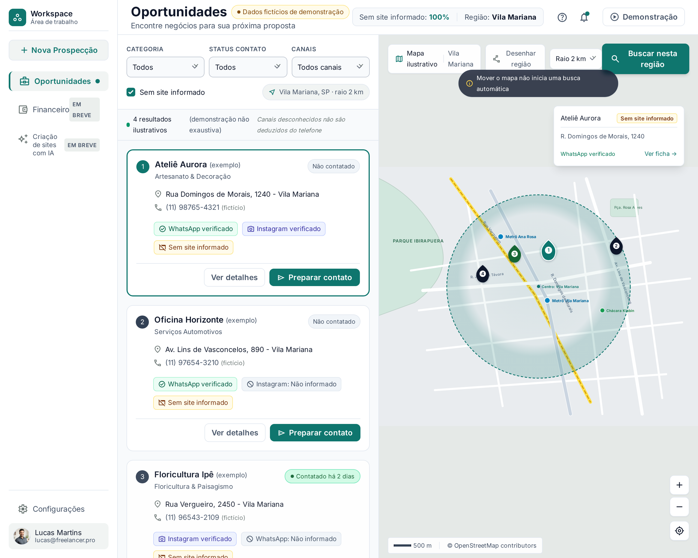
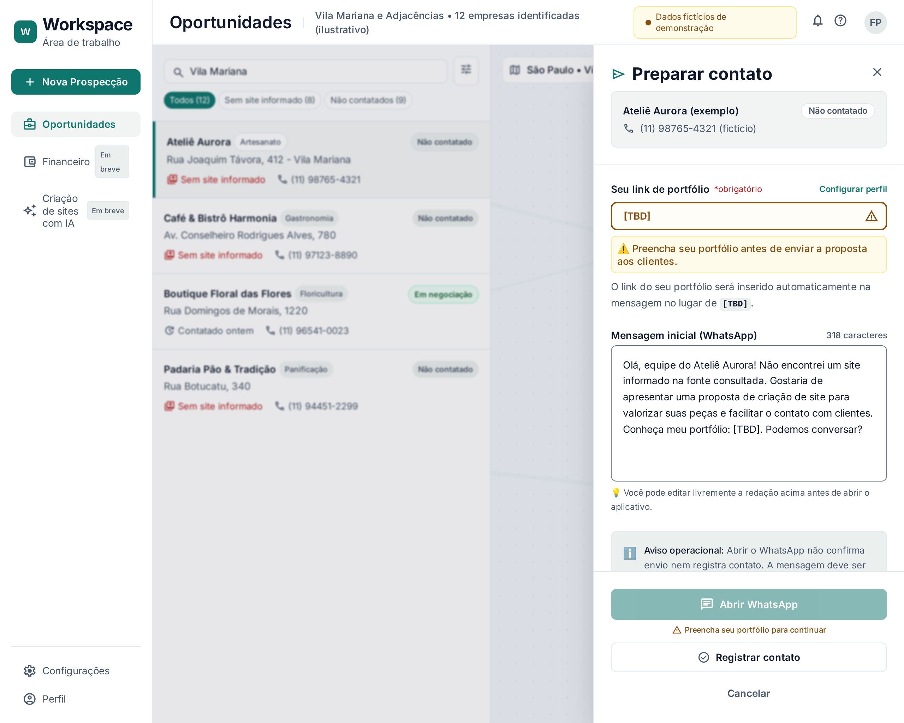

# Freelancer Workspace design assets

Visual direction: approved. Seven desktop mockups generated with Stitch and available for review. Screen approval is pending.

[Open Stitch project](https://stitch.withgoogle.com/projects/8650887222206239999) · [Approved visual direction](DESIGN-PROPOSAL.md) · [Design system](../.stitch/DESIGN.md) · [Metadata](../.stitch/metadata.json)

## Screen exports

| Screen | Screenshot | HTML reference |
| --- | --- | --- |
| Oportunidades | [PNG](../.stitch/designs/opportunities-results.png) | [HTML](../.stitch/designs/opportunities-results.html) |
| Selecionar região | [PNG](../.stitch/designs/region-selection.png) | [HTML](../.stitch/designs/region-selection.html) |
| Detalhes da empresa | [PNG](../.stitch/designs/company-details.png) | [HTML](../.stitch/designs/company-details.html) |
| Preparar contato | [PNG](../.stitch/designs/contact-preparation.png) | [HTML](../.stitch/designs/contact-preparation.html) |
| Buscando oportunidades | [PNG](../.stitch/designs/opportunities-loading.png) | [HTML](../.stitch/designs/opportunities-loading.html) |
| Nenhum resultado | [PNG](../.stitch/designs/opportunities-empty.png) | [HTML](../.stitch/designs/opportunities-empty.html) |
| Erro na busca | [PNG](../.stitch/designs/opportunities-error.png) | [HTML](../.stitch/designs/opportunities-error.html) |

## Review and implementation notes

Original Stitch exports are preserved in `.stitch/designs/`. The HTML files are visual references and may load external fonts, icons and Tailwind from a CDN. They are not application components.

The mockups cover results, region selection, company details, contact preparation, loading, empty and recoverable error. Company data, source references, result counts and maps are illustrative. Opening WhatsApp and registering contact are separate actions; the missing portfolio remains `[TBD]`.

The approved tokens are documented in `.stitch/DESIGN.md`. Use the main results screen as the structural reference when implementing shared navigation, filters and maps; generated screens still vary in sample data, placeholder icons and some spacing. Validate responsive layouts, long select values, drawer scrolling and accessibility during implementation. Screenshot dimensions are recorded in metadata and differ from the logical 1440 × 1000 desktop target.

No new brand, real portfolio URL or operational integration has been approved by these exports. Copy selected exports into this folder after screen review; retain the source files intact.

## Preview

